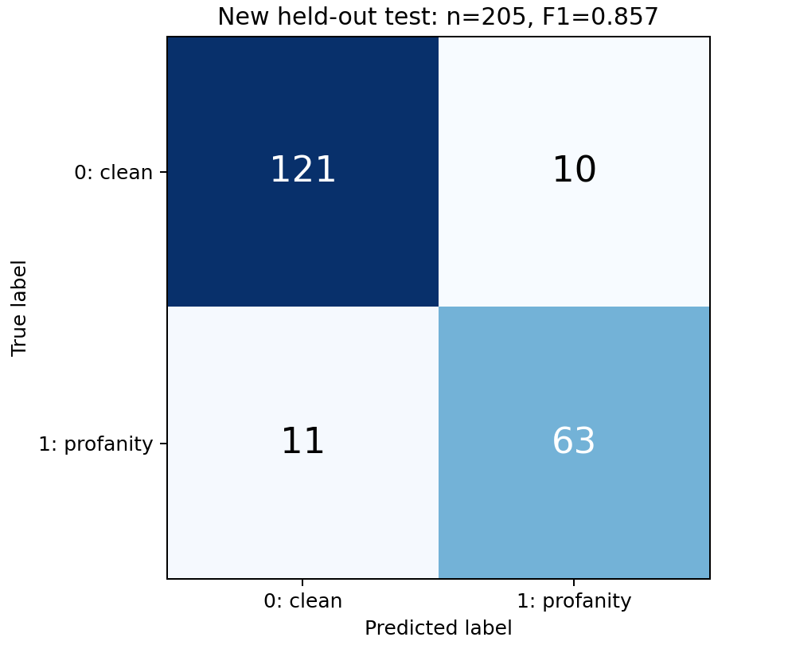

# Kazakh Profanity Detection — 2,000-example edition

KBTU · DSSC5113 · Bonus Project · Fall 2026 · Dataset version 2.0

**Input:** one Kazakh review/comment, optionally mixed with Russian. **Output:** 0 = no identifiable Kazakh profanity, 1 = Kazakh profanity present, plus a probability estimate and logit/decision score.

This educational project includes a trained character TF-IDF + Logistic Regression model, fixed labeled data and splits, preparation/training/evaluation/inference code, a Colab notebook, saved results, error analysis, and a defense guide. CPU is sufficient; no paid API or GPU is needed.

**Annotation disclosure:** all new labels are AI contextual annotations without independent human verification. All synthetic examples are explicitly identified. This selected benchmark does not establish production moderation accuracy.

## Dataset: exactly 70% real and 30% synthetic

| Origin | Clean (0) | Profane (1) | Total | Share |
|---|---:|---:|---:|---:|
| Real reviews, annotated by AI | 946 | 454 | **1,400** | **70%** |
| Clearly marked synthetic examples | 300 | 300 | **600** | **30%** |
| Total | 1,246 | 754 | **2,000** | 100% |

Source: [KazSAnDRA](https://github.com/IS2AI/KazSAnDRA), by Rustem Yeshpanov and Huseyin Atakan Varol, [LREC-COLING 2024](https://aclanthology.org/2024.lrec-main.844/), dataset license CC BY 4.0. The retained real subset contains **655 physical-marketplace reviews and 745 app/digital-product reviews**. The original ratings are sentiment labels, not our profanity labels. They were used only to enrich sampling for complaints.

V2 adds 1,016 contextually reviewed real texts to the original 384, and 408 marked synthetic examples to the original 192. The 408 additions use 34 AI-authored scenarios × 6 product substitutions × 2 labels. They are templated constructed text, not 408 independently collected reviews. **All products and labels from one template stay in one split.** There are 300 contrast pairs across 130 scenario families. No rows were copied merely to reach the count; normalized texts are unique.

Files: `data/base_annotations.csv` (fixed annotation record), `data/labeled.csv` (normalized text/groups/splits), `data/annotation_decisions_v2.csv` (1,016 added AI judgments), `data/synthetic_scenarios.json` (generation templates), `data/synthetic_additions.csv`, and `data/source_manifest.json` (pinned source archive/checksum). See [data card](docs/DATA_CARD.md), [annotation policy](docs/ANNOTATION_POLICY.md), and [data licensing](DATA_LICENSE.md).

## Labeling policy

- Identifiable Kazakh obscene words/expressions, inflections, recognizable misspellings, partial masks, and established obscene abbreviations → 1.
- Negative sentiment, anger, ordinary insults (`ақымақ`, `мал`, `өтірікші`) alone → 0.
- Kazakh profanity inside mixed-language text → 1. Russian-only profanity without Kazakh profanity → 0 under the narrow task policy; this does not mean the text is safe.
- Quoted or negated profanity still counts as present. Unrecoverable `****` alone does not.
- Harmless fragments in `тамаша`, `аманат`, `кісіге`, and `есігі` do not automatically count.

Synthetic labeled examples:

| Review | Label | Explanation |
|---|---:|---|
| Телефон екі күннен кейін өшіп қалды, ақшамды қайтарыңыздар. | 0 | Complaint without profanity |
| Қотақ, телефон екі күннен кейін өшіп қалды, ақшамды қайтарыңыздар. | 1 | Explicit Kazakh profanity |
| Робот шаңсорғыш кілемге шыға алмайды, қ*тақ. | 1 | Recognizable partial masking |
| Сатушы «қотақ деп жазбаңыз» деп жауап берді. | 1 | Quoted profanity is present |

Reviewer profile data are not included. Identifying-person/handle contexts were excluded. Runtime normalization masks contact-like digit strings, URLs, email addresses, and @handles; names need contextual review.

## Split and holdout protection

| Split | Real 0 | Real 1 | Synthetic 0 | Synthetic 1 | Total |
|---|---:|---:|---:|---:|---:|
| Train | 673 | 328 | 212 | 212 | **1,425** |
| Validation | 135 | 64 | 44 | 44 | **287** |
| Test | 138 | 62 | 44 | 44 | **288** |

Seed **42**; **1,529 groups**. A seven-fold stratified group allocation is combined with saved prior split assignments: a group containing an old test example remains test. Old validation groups cannot move into train. Synthetic pairs and all products from the same generated template remain together. No exact normalized duplicates were found. Punctuation-insensitive duplicate keys and fixed-hash character similarities ≥0.90 are grouped before allocation. Maximum cross-split similarity under this method: **0.8040**. The method does not guarantee discovery of every semantic paraphrase.

The 83 original test examples were already inspected in v1. They remain held out, but they are **not called a new untouched test**. The **205 newly added test examples** contain none of the original 576 IDs and provide the primary v2 evaluation. The cohort is saved in `evaluation_cohort`. The unchanged v1 results are retained under `results/history_v1/` for transparency.

## Model and preprocessing

Unicode NFKC → case folding → contact masking → whitespace normalization → character TF-IDF (2–5 grams) → Logistic Regression → threshold **0.40**.

Keep Kazakh letters, punctuation, asterisks, and ordinary digits. Do not translate, stem, remove stopwords, or automatically correct spelling. The vectorizer learns vocabulary and IDF **only from training text** (`min_df=2`, maximum 80,000 features, sublinear TF, default L2 normalization). The fitted vocabulary has **19,940 character n-grams**. Unknown words can share known fragments; completely unseen fragments are ignored. The full comment is processed without token truncation, but unusually long comments are not independently validated.

The model minimizes L2-regularized binary logistic loss. Validation searched C={0.5,1,2}, class weighting={none,balanced}, and 13 thresholds from 0.20 to 0.80. The selected model uses **C=2.0, balanced class weights, liblinear, max_iter=2000, seed=42**. Validation precision **0.9346**, recall **0.9259**, F1 **0.9302**. All selection used validation; the fitted model was then frozen, without refitting on train+validation or changing settings after test inspection.

For vector x: `z = intercept + w·x`, `p = 1/(1+exp(-z))`, and `label = int(p >= 0.40)`. The probability is uncalibrated and is not real marketplace prevalence. Short fragments can cause false positives, and a short profane word can be diluted inside a long clean context.

## Results

| Evaluation scope | n | Positive labels | Precision | Recall | F1 |
|---|---:|---:|---:|---:|---:|
| **New test only — primary** | **205** | **74** | **0.8630** | **0.8514** | **0.8571** |
| New real reviews only | 145 | 44 | 0.9167 | 1.0000 | 0.9565 |
| All retained test examples, including legacy | 288 | 106 | 0.8932 | 0.8679 | 0.8804 |
| All real test reviews | 200 | 62 | 0.9231 | 0.9677 | 0.9449 |
| All synthetic test examples | 88 | 44 | 0.8421 | 0.7273 | 0.7805 |

Primary confusion matrix, rows=true and columns=predicted:

| | Predicted 0 | Predicted 1 |
|---|---:|---:|
| True 0 | 121 | 10 |
| True 1 | 11 | 63 |



Precision = 63/(63+10); recall = 63/(63+11); F1 is their harmonic mean. False positives can suppress legitimate reviews; false negatives leave profanity visible. Threshold costs differ between automatic deletion and routing to a moderator; this educational experiment selected validation F1.

The real marketplace test subgroup contains 102 clean comments, two false positives, and **no positive labels**, so physical-goods profanity recall remains unmeasured. Newly held-out template families account for repeated synthetic errors. A larger dataset did not guarantee a higher mixed F1, and the v1 and v2 scores are not directly comparable because their test composition differs.

Saved files: `results/new_test_metrics.json` and `new_test_predictions.csv` for primary results; `results/metrics.json` and `test_predictions.csv` for all test/cohort/subgroup results. [Error analysis](results/ERROR_ANALYSIS.md) discusses actual false positives and false negatives. Settings were not adjusted to repair those observed test mistakes.

## Predict without retraining

Use Python **3.12** (tested 3.12.14), from the repository root:

```bash
python -m venv .venv
source .venv/bin/activate
python -m pip install -r requirements.txt
python -m src.predict --text "Тауар сапасы жақсы, жеткізу жылдам."
python -m src.predict --text "Мына қотақ телефон тағы өшіп қалды." --explain
```

Windows activation: `.venv\Scripts\activate`. Python function:

```python
from src.predict import predict
print(predict("Тауар сапасы жақсы."))
```

The downloadable model is [artifacts/model.joblib](artifacts/model.joblib). It includes the fitted vectorizer, IDF, classifier, and threshold. Shared normalization is in `src/common.py`; no additional tokenizer or model download is needed. Empty input is rejected. Only load trusted joblib files. The `--explain` option lists overlapping character-feature contributions to the linear score, not causal explanations.

## Google Colab and reproduction

Open [notebooks/Project_Colab.ipynb](notebooks/Project_Colab.ipynb) in a fresh Colab runtime. Upload the complete project ZIP when prompted. The notebook installs pinned packages, loads the saved model, accepts custom text, and shows primary and all-test results. Optional `RUN_TRAINING=True` reproduces training in separate output folders. Its code cells were executed locally; a live fresh-Colab session was not available for validation.

To reproduce locally:

```bash
python -m src.prepare_data
python -m src.train --output-dir artifacts/retrained
python -m src.evaluate --model artifacts/retrained/model.joblib --output-dir results/retrained
python -m unittest discover -s tests -v
```

The optional `python -m src.download_source` downloads the pinned source and verifies the archive checksum and all 1,400 real source texts. `python -m src.build_synthetic` reconstructs the 408 explicitly templated additions from the supplied scenario file. Neither is needed for routine inference/training because fixed labeled data are included.

The annotation CSV records the AI judgments; reproducing training does not require regenerating labels with GPT. It also does not validate those labels. `src.evaluate` refuses to overwrite existing metrics by default. Use a fresh output folder. Future changes made after reading test errors require a new untouched evaluation set for an unbiased new claim.

## Limitations, acknowledgment, and submission

AI labels lack independent human verification. The positive real-review pool is lexicon-enriched and mostly one obscene word family. Real positives come from app reviews, with a physical-goods domain gap. Synthetic rows are correlated within template families and do not constitute 600 independent human observations. See the data card and saved cohort results.

AI assistance included implementation, contextual annotation, synthetic construction, training, evaluation, and documentation. Record your **actual** student contribution honestly and understand the code before the individual defense. See [defense guide](docs/DEFENSE_GUIDE.md) and [submission checklist](SUBMISSION_CHECKLIST.md).

GitHub publication and the Teams submission have not been performed. Upload the project contents, keep data/model accessible, add your full name and student ID, and submit the GitHub link by **21 November 2026**. Code: MIT (`LICENSE`); source-text rights and attribution: `DATA_LICENSE.md`.
